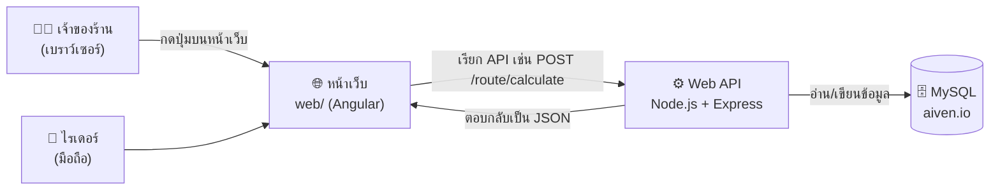
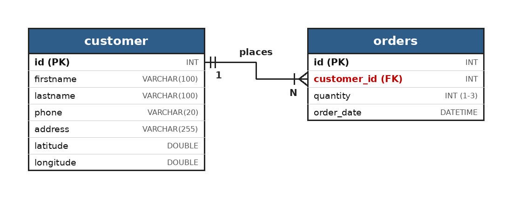
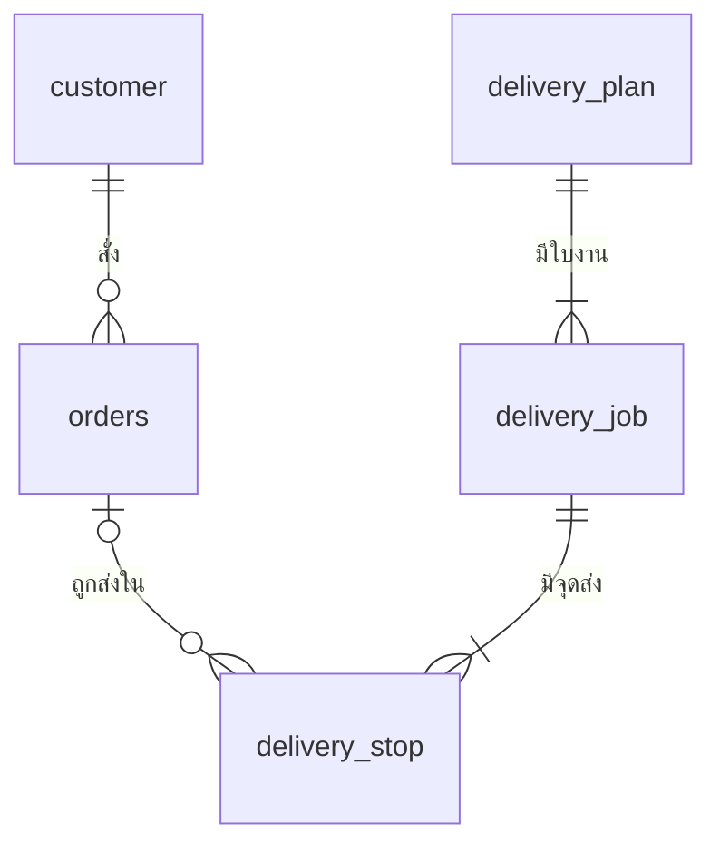

# 🍱 LunchFlow

**ระบบจัดเส้นทางและแบ่งงานไรเดอร์ สำหรับร้านข้าวกล่องส่งด่วนมื้อเที่ยง**
(ร้านอยู่ใกล้มหาวิทยาลัยมหาสารคาม)

| | ลิงก์ |
|---|---|
| 🌐 หน้าเว็บ | https://lunchflow-app.onrender.com |
| ⚙️ Web API | https://lunchflow-u723.onrender.com |
| 📘 คู่มือ API ทุกเส้น | [docs/API-GUIDE.md](docs/API-GUIDE.md) |

> **ลองใช้ได้ทันที:** เปิดหน้าเว็บ → กด **เจ้าของร้าน** → ชื่อผู้ใช้ `owner` รหัสผ่าน `1234`
>
> เซิร์ฟเวอร์เป็นแบบฟรี ถ้าไม่มีคนใช้นาน ๆ จะหลับ การเปิดครั้งแรกอาจต้องรอประมาณ 1 นาที

---

## สารบัญ

1. [โปรเจกต์นี้คืออะไร](#1-โปรเจกต์นี้คืออะไร)
2. [ทำอะไรได้บ้าง](#2-ทำอะไรได้บ้าง)
3. [คำศัพท์ที่ควรรู้ก่อน](#3-คำศัพท์ที่ควรรู้ก่อน)
4. [ระบบทำงานยังไง](#4-ระบบทำงานยังไง)
5. [เงื่อนไขของร้าน](#5-เงื่อนไขของร้าน)
6. [ระบบคิดเส้นทางยังไง](#6-ระบบคิดเส้นทางยังไง)
7. [ฐานข้อมูล](#7-ฐานข้อมูล)
8. [ไฟล์และโฟลเดอร์ในโปรเจกต์](#8-ไฟล์และโฟลเดอร์ในโปรเจกต์)
9. [วิธีรันในเครื่องตัวเอง (ทีละขั้น)](#9-วิธีรันในเครื่องตัวเอง-ทีละขั้น)
10. [Web API ทั้งหมด](#10-web-api-ทั้งหมด)
11. [การนำขึ้นเว็บจริง (Deploy บน Render)](#11-การนำขึ้นเว็บจริง-deploy-บน-render)
12. [ปัญหาที่พบบ่อย](#12-ปัญหาที่พบบ่อย)
13. [เทคโนโลยีที่ใช้](#13-เทคโนโลยีที่ใช้)

---

## 1. โปรเจกต์นี้คืออะไร

ร้านข้าวกล่องร้านหนึ่งรับออเดอร์ช่วงเช้าวันละ 20–30 รายการ ต้อง **ออกจากร้าน 11:30 และส่งให้ถึงลูกค้าทุกคนก่อน 12:30**
ไรเดอร์ 1 คนรับได้ไม่เกิน 3 ออเดอร์ และค่าไรเดอร์คิดตามระยะทางกับจำนวนกล่องที่ถือ

ถ้าให้เจ้าของร้านนั่งแบ่งงานเอง จะต้องคิดว่า
- ใครควรส่งบ้านไหนบ้าง
- ควรไปบ้านไหนก่อนหลัง
- จะส่งทันเที่ยงครึ่งไหม
- สรุปแล้วรอบนี้กำไรหรือขาดทุน

**LunchFlow ช่วยคิดเรื่องพวกนี้ให้ในการกดปุ่มเดียว** แล้วออก "ใบงาน" ให้ไรเดอร์แต่ละคนเปิดดูบนมือถือได้เลย

---

## 2. ทำอะไรได้บ้าง

### 👩‍🍳 ฝั่งเจ้าของร้าน (เปิดบนคอมหรือแท็บเล็ต)

| หน้า | ทำอะไรได้ |
|---|---|
| **ภาพรวม** | ดูจำนวนลูกค้า ออเดอร์ กล่อง ยอดขาย และแผนล่าสุด |
| **ลูกค้า** | เพิ่ม แก้ไข ลบ ค้นหาลูกค้าจากชื่อ และดูบ้านลูกค้าบนแผนที่ (คลิกแผนที่เพื่อเลือกพิกัดบ้านได้) |
| **ออเดอร์** | สุ่มออเดอร์ 20–30 รายการ เพิ่ม ลบ แก้จำนวนกล่อง (1–3) และล้างทั้งหมด |
| **จัดเส้นทาง** | กดคำนวณ ระบบจะแบ่งงานและวาดเส้นทางแยกสีต่อไรเดอร์ ถ้าไม่ชอบกด "คำนวณใหม่" เพื่อดูแผนอื่นพร้อมตารางเทียบ พอใจแล้วกด "ยืนยัน" เพื่อออกใบงาน ด้านข้างแผนที่สรุปยอดขาย ต้นทุนอาหาร ค่าไรเดอร์ กำไร/ขาดทุน และเวลาส่งเสร็จ |

ระบบจะเตือนเมื่อ
- 🔴 แผนนี้ขาดทุน
- 🟡 มีไรเดอร์ที่อาจส่งไม่ทัน 12:30

### 🛵 ฝั่งไรเดอร์ (เปิดบนมือถือ)

1. เปิดเว็บแล้วกด **ไรเดอร์**
2. กรอกเลขใบงานที่ร้านให้ เช่น `1001`
3. เห็นว่าต้องหยิบกี่กล่อง และต้องไปส่งบ้านไหนก่อนหลัง พร้อมชื่อ ที่อยู่ เวลาที่ควรถึง
4. กดโทรหาลูกค้าได้ทันที และกด **เปิดแผนที่นำทาง** ไป Google Maps ได้ (ผ่านทุกจุดตามลำดับ)

---

## 3. คำศัพท์ที่ควรรู้ก่อน

ถ้าไม่เคยเขียนเว็บมาก่อน อ่านส่วนนี้ก่อนจะเข้าใจส่วนที่เหลือง่ายขึ้น

| คำ | ความหมายแบบง่าย ๆ | ในโปรเจกต์นี้ |
|---|---|---|
| **Frontend** | หน้าตาเว็บที่คนเห็นและกดได้ | โฟลเดอร์ `web/` เขียนด้วย Angular |
| **Backend** | โปรแกรมหลังบ้าน รับคำสั่งจากหน้าเว็บ ไปอ่าน/เขียนฐานข้อมูล แล้วตอบกลับ | ไฟล์ที่อยู่นอก `web/` ทั้งหมด เขียนด้วย Node.js + Express |
| **API** | "ช่องทางสั่งงาน" ที่หน้าเว็บใช้คุยกับหลังบ้าน เช่น `GET /customer` แปลว่า "ขอรายชื่อลูกค้าทั้งหมด" | มี 20 เส้น ดูข้อ 10 |
| **Database (ฐานข้อมูล)** | ที่เก็บข้อมูลถาวร เหมือนตาราง Excel หลาย ๆ แผ่น | MySQL บน aiven.io มี 6 ตาราง |
| **JSON** | รูปแบบข้อความที่ใช้ส่งข้อมูลระหว่างหน้าเว็บกับหลังบ้าน เช่น `{"firstname": "สมชาย"}` | API ทุกเส้นรับส่งเป็น JSON |
| **Deploy** | เอาโปรแกรมขึ้นอินเทอร์เน็ตให้คนอื่นเปิดได้ | ใช้ Render.com (ฟรี) |
| **Repository (repo)** | โฟลเดอร์โปรเจกต์ที่เก็บไว้บน GitHub พร้อมประวัติการแก้ไข | หน้านี้ |
| **.env** | ไฟล์เก็บรหัสลับ เช่น รหัสฐานข้อมูล **ห้ามอัปขึ้น GitHub** | มีตัวอย่างใน `.env.example` |

---

## 4. ระบบทำงานยังไง



ตัวอย่างตอนเจ้าของร้านกด **"คำนวณเส้นทาง"**
1. หน้าเว็บส่งคำสั่ง `POST /route/calculate` ไปที่ Web API
2. Web API ดึงออเดอร์ทั้งหมดจากฐานข้อมูล แล้วส่งให้ตัวจัดเส้นทาง (`utils/route-planner.ts`) คิด
3. Web API ตอบแผนกลับมาเป็น JSON: ไรเดอร์กี่คน ใครส่งบ้านไหน ระยะทาง เวลา ค่าใช้จ่าย กำไร
4. หน้าเว็บเอาข้อมูลนั้นมาวาดแผนที่และการ์ดสรุป

พอกด **"ยืนยัน"** Web API จะบันทึกแผนลงฐานข้อมูลและออกเลขใบงาน (เริ่มที่ 1001)
ไรเดอร์เอาเลขนี้ไปเปิดดูได้จากมือถือของตัวเอง

---

## 5. เงื่อนไขของร้าน

แก้ค่าได้ที่ไฟล์ [`config/shop.ts`](config/shop.ts)

| เรื่อง | ค่า |
|---|---|
| ราคาขาย | 65 บาท / กล่อง |
| ต้นทุนอาหาร | 40 บาท / กล่อง |
| ค่าไรเดอร์ | 15 บาท ต่อคน + 2 บาท × จำนวนกล่องที่ถือ × ระยะทาง (กม.) |
| ไรเดอร์ 1 คน | ไม่เกิน 3 ออเดอร์ |
| ความเร็วเฉลี่ย | 30 กม./ชม. และใช้เวลาส่งจุดละ 2 นาที |
| เวลา | ออกจากร้าน 11:30 ต้องถึงลูกค้าทุกคนไม่เกิน 12:30 |
| ลูกค้า | อยู่รอบร้านในระยะ 3 กม. สั่งได้ครั้งละ 1–3 กล่อง |

**ตัวอย่างค่าไรเดอร์:** ถือ 5 กล่อง วิ่งรวม 2 กม. → 15 + (2 × 5 × 2) = **35 บาท**

---

## 6. ระบบคิดเส้นทางยังไง

อยู่ในไฟล์ [`utils/route-planner.ts`](utils/route-planner.ts) แบ่งเป็น 5 ขั้น

**ขั้นที่ 1: แบ่งออเดอร์เป็นกลุ่ม กลุ่มละไม่เกิน 3 ออเดอร์** (1 กลุ่ม = ไรเดอร์ 1 คน)
ลองแบ่ง 5 วิธี เพื่อให้มีแผนสำรองให้เลือก
- **กวาดรอบร้าน** (3 แบบ): เรียงบ้านลูกค้าตามทิศรอบร้านเหมือนเข็มนาฬิกา แล้วตัดทีละ 3 บ้าน โดยแต่ละแบบเริ่มตัดจากตำแหน่งต่างกัน
- **จับกลุ่มเพื่อนบ้าน** (2 แบบ): เลือกบ้านตั้งต้น (บ้านไกลสุดหรือใกล้สุดจากร้าน) แล้วจับกลุ่มกับบ้านที่อยู่ใกล้กันที่สุด

**ขั้นที่ 2: สลับออเดอร์ระหว่างกลุ่มเพื่อลดระยะรวม**
นำผลของทั้ง 5 วิธีมาลองสลับบ้านระหว่างไรเดอร์ 2 คน หรือย้ายบ้านไปให้ไรเดอร์ที่ยังรับไม่ครบ 3 ออเดอร์
ถ้าระยะรวมสั้นลงก็ใช้แบบใหม่ ทำซ้ำจนสลับแล้วไม่สั้นลงอีก ได้แผนเพิ่มอีก 5 แผน
แผนที่แบ่งกลุ่มเหมือนกันจะถูกตัดออก ปุ่ม "คำนวณใหม่" จึงได้แผนที่ต่างกันจริงทุกครั้ง (ออเดอร์ 20–30 รายการได้อย่างน้อย 3 แผน)

**ขั้นที่ 3: เรียงลำดับบ้านในแต่ละกลุ่ม**
ลองทุกลำดับที่เป็นไปได้ (3 บ้าน = 6 แบบ) แล้วเลือกลำดับที่ระยะทางรวมสั้นที่สุด

**ขั้นที่ 4: คิดเวลาและเงิน**
- เวลาถึงแต่ละบ้าน = 11:30 + เวลาขับ (ระยะสะสม ÷ 30 กม./ชม.) + 2 นาที × จำนวนจุดที่แวะมาก่อนหน้า (ปัดเศษนาทีขึ้น)
- เวลาที่แวะจุดสุดท้ายไม่นับ เพราะลูกค้าได้ของตอนไรเดอร์ถึงบ้าน เวลาส่งเสร็จจึงเท่ากับเวลาถึงจุดสุดท้ายบนใบงาน
- "ส่งทัน" ตัดสินจากเวลาถึงของทุกจุดที่แสดงบนใบงาน ต้องไม่เกิน 12:30
- ค่าไรเดอร์ = 15 + 2 × กล่อง × กม. ยอดขาย ต้นทุน และกำไร คิดจากตัวเลขนี้

**ขั้นที่ 5: เรียงแผนจากดีไปแย่ และแนบคำเตือน**
แผนที่ส่งทันทุกบ้านมาก่อน จากนั้นเรียงตามค่าส่งจากถูกไปแพง
แผนแรกคือแผนที่ดีที่สุด ส่วนปุ่ม "คำนวณใหม่" จะเลื่อนไปดูแผนถัดไป
แต่ละแผนมี `warnings` บอกเหตุผลเมื่อมีปัญหา ได้แก่ แผนขาดทุนเท่าไร และไรเดอร์คนไหนส่งจุดไหน (ออเดอร์ไหน) ไม่ทัน

**กรณีพิเศษ:** ไม่มีออเดอร์ → API ตอบ 400 ให้เพิ่มออเดอร์ก่อน, ออเดอร์เดียว → ได้ 1 แผน ไรเดอร์ 1 คน, ออเดอร์ 30 รายการ → ใช้ไรเดอร์ 10 คน

**ทดสอบ:** รัน `npm test` เพื่อตรวจว่าไม่มีกลุ่มเกิน 3 ออเดอร์ ทุกออเดอร์ถูกแบ่งครบไม่ซ้ำ สถานะส่งทันถูกต้อง สูตรค่าส่งถูกต้อง และคำนวณใหม่ได้แผนต่างกัน (ไฟล์ [`test/route-planner.test.ts`](test/route-planner.test.ts))

> **ข้อจำกัด:** ระยะทางวัดเป็นเส้นตรงระหว่างพิกัด ไม่ใช่ระยะตามถนนจริง และนับจากร้านถึงบ้านสุดท้าย (ไม่นับขากลับ)
> ตัวเลขเวลาและค่าใช้จ่ายจึงเป็นค่าประมาณสำหรับวางแผน

---

## 7. ฐานข้อมูล





| ตาราง | เก็บอะไร |
|---|---|
| `customer` | ลูกค้า: ชื่อ นามสกุล เบอร์โทร ที่อยู่ ละติจูด ลองจิจูด |
| `orders` | ออเดอร์: ลูกค้าคนไหนสั่ง กี่กล่อง (1–3) เวลาที่สั่ง |
| `delivery_plan` | แผนที่เจ้าของร้านกดยืนยัน + สรุปเงินและเวลาของรอบ |
| `delivery_job` | ใบงานของไรเดอร์ 1 คน (`id` คือเลขใบงาน เริ่มที่ 1001) |
| `delivery_stop` | บ้านที่ต้องไปส่งในใบงาน เรียงตามลำดับ (เก็บชื่อและที่อยู่ไว้ด้วย ใบงานจึงไม่หายถึงจะล้างออเดอร์แล้ว) |

ไฟล์สร้างตารางทั้งหมด (6 ตาราง) และลูกค้าตัวอย่าง 30 คนอยู่ที่ [`database/lunchbox.sql`](database/lunchbox.sql)

---

## 8. ไฟล์และโฟลเดอร์ในโปรเจกต์

```
LunchFlow/
│
├── server.ts               ⬅ จุดเริ่มต้น: เปิดเซิร์ฟเวอร์ที่พอร์ต 3000
├── app.ts                  รวมเส้นทาง API ทั้งหมด + อนุญาตให้หน้าเว็บเรียกข้ามโดเมน (CORS)
├── dbconnect.ts            เชื่อมต่อ MySQL (อ่านรหัสจากไฟล์ .env)
├── .env.example            ตัวอย่างไฟล์ .env
├── package.json            รายชื่อแพ็กเกจที่ใช้ + คำสั่ง npm
│
├── config/shop.ts          ข้อมูลร้าน พิกัด ราคา เงื่อนไขคิดเงิน สีของไรเดอร์
├── controller/             แต่ละไฟล์ = API 1 กลุ่ม
│   ├── customer.ts         /customer  (ลูกค้า)
│   ├── order.ts            /order     (ออเดอร์)
│   ├── route.ts            /route     (คำนวณและยืนยันเส้นทาง)
│   └── job.ts              /job       (ใบงานไรเดอร์)
├── model/                  รูปร่างของข้อมูล (มีช่องอะไรบ้าง ชนิดอะไร)
├── utils/
│   ├── distance.ts         คำนวณระยะทางระหว่าง 2 พิกัด (สูตร Haversine)
│   └── route-planner.ts    ⭐ ตัวจัดเส้นทาง หัวใจของระบบ
├── database/
│   ├── lunchbox.sql        สร้างตาราง 6 ตาราง + ลูกค้าตัวอย่าง 30 คน
│   └── setup.ts            รันไฟล์ .sql ให้อัตโนมัติ (npm run setup-db)
├── docs/
│   ├── API-GUIDE.md        คู่มือ API ทุกเส้น พร้อมตัวอย่าง
│   └── er-diagram.png      รูปความสัมพันธ์ของตาราง
├── postman/                ไฟล์สำหรับทดสอบ API ด้วยโปรแกรม Postman
│
└── web/                    🌐 หน้าเว็บ (Angular) แยกเป็นอีกโปรเจกต์
    ├── start.bat           ดับเบิลคลิกเพื่อรันหน้าเว็บบน Windows
    └── src/app/
        ├── app.routes.ts   URL ทั้งหมดของหน้าเว็บ
        ├── config/api.ts   ที่อยู่ของ Web API
        ├── service/api.ts  ฟังก์ชันเรียก API ทุกเส้น
        ├── components/     แผนที่เส้นทาง (ใช้ซ้ำหลายหน้า)
        └── pages/
            ├── home/       หน้าแรก (เลือกเจ้าของร้าน / ไรเดอร์)
            ├── login/      เข้าสู่ระบบเจ้าของร้าน
            ├── owner/      หน้าเจ้าของร้านทั้งหมด
            └── rider/      หน้าไรเดอร์ทั้งหมด
```

รายละเอียดฝั่งหน้าเว็บเพิ่มเติม: [web/README.md](web/README.md)

---

## 9. วิธีรันในเครื่องตัวเอง (ทีละขั้น)

> ถ้าแค่อยากลองใช้ ไม่ต้องทำส่วนนี้ เปิดลิงก์หน้าเว็บด้านบนได้เลย

### ขั้นที่ 0: ติดตั้งโปรแกรมที่ต้องใช้ (ทำครั้งเดียว)

| โปรแกรม | ใช้ทำอะไร | ดาวน์โหลด |
|---|---|---|
| **Node.js 24 (LTS)** | ใช้รันโค้ด JavaScript/TypeScript และมีคำสั่ง `npm` มาด้วย | https://nodejs.org |
| **Git** | ใช้ดาวน์โหลดโปรเจกต์จาก GitHub | https://git-scm.com |
| **VS Code** (แนะนำ) | โปรแกรมเปิดและแก้โค้ด | https://code.visualstudio.com |

ตรวจว่าติดตั้งสำเร็จ: เปิด Terminal (Windows ใช้ **Command Prompt** หรือ **PowerShell**) แล้วพิมพ์
```shell
node -v
git -v
```
ถ้าขึ้นเลขเวอร์ชัน เช่น `v24.x.x` แปลว่าพร้อมแล้ว

### ขั้นที่ 1: ดาวน์โหลดโปรเจกต์
```shell
git clone https://github.com/YAJO007/LunchFlow.git
cd LunchFlow
```

### ขั้นที่ 2: เตรียมฐานข้อมูล (aiven.io ฟรี)
1. สมัครและเข้า https://console.aiven.io
2. กด **Create service** → เลือก **MySQL** → แผน **Free**
3. รอสถานะเป็น Running แล้วดูหน้า **Overview** จดค่า Host, Port, User, Password, Database name
4. ในโฟลเดอร์ LunchFlow คัดลอกไฟล์ `.env.example` แล้วตั้งชื่อใหม่เป็น `.env`
5. เปิด `.env` แล้วใส่ค่าที่จดไว้
   ```
   DB_HOST=mysql-xxxx.aivencloud.com
   DB_PORT=12345
   DB_USER=avnadmin
   DB_PASSWORD=รหัสผ่านจาก aiven
   DB_NAME=defaultdb
   ```

### ขั้นที่ 3: รัน Web API (หลังบ้าน)
```shell
npm install          # ติดตั้งแพ็กเกจ (ครั้งแรกครั้งเดียว)
npm run setup-db     # สร้างตาราง + ลูกค้าตัวอย่าง 30 คน
npm run dev          # เปิด API ที่ http://localhost:3000
```
ถ้าเห็น `Server is started on port 3000` แปลว่าสำเร็จ ลองเปิด http://localhost:3000/customer ในเบราว์เซอร์ จะเห็นรายชื่อลูกค้า

> ⚠️ `npm run setup-db` จะ **ลบข้อมูลเดิมทั้งหมด** แล้วสร้างใหม่ ใช้ตอนตั้งค่าครั้งแรกเท่านั้น

### ขั้นที่ 4: รันหน้าเว็บ
เปิด Terminal **หน้าต่างใหม่** (หน้าต่างเดิมปล่อยให้ API รันไว้) แล้วพิมพ์
```shell
cd web
npm install          # ครั้งแรกครั้งเดียว ใช้เวลาสักพัก
npm start            # เปิดเว็บที่ http://localhost:4200 ให้อัตโนมัติ
```
บน Windows จะดับเบิลคลิกไฟล์ `web/start.bat` แทนก็ได้

### ขั้นที่ 5: ให้หน้าเว็บใช้ API ในเครื่อง
ตอนเริ่มต้น หน้าเว็บจะเรียก API บน Render
ถ้าอยากให้ใช้ API ในเครื่อง ให้เปิดไฟล์ `web/src/app/config/api.ts` แล้วเปลี่ยน `API_URL` เป็น `'http://localhost:3000'`

### สรุปคำสั่ง

| ทำที่ | คำสั่ง | ทำอะไร |
|---|---|---|
| โฟลเดอร์หลัก | `npm run setup-db` | สร้างตาราง + ข้อมูลตัวอย่าง |
| โฟลเดอร์หลัก | `npm run dev` | รัน API แบบพัฒนา (แก้โค้ดแล้วรีสตาร์ตเอง) |
| โฟลเดอร์หลัก | `npm test` | ทดสอบระบบคำนวณเส้นทางและต้นทุน |
| โฟลเดอร์หลัก | `npm run build` แล้ว `npm start` | แปลงเป็น JavaScript แล้วรันแบบใช้งานจริง |
| `web/` | `npm start` | รันหน้าเว็บแบบพัฒนา |
| `web/` | `npm run build` | สร้างไฟล์หน้าเว็บไว้ deploy (อยู่ที่ `web/dist/lunchflow-web/browser`) |

---

## 10. Web API ทั้งหมด

คู่มือฉบับเต็มพร้อมตัวอย่างข้อมูลที่ส่งและได้กลับ: **[docs/API-GUIDE.md](docs/API-GUIDE.md)**

| # | Method | Path | ใช้ทำอะไร |
|---|---|---|---|
| 1 | GET | `/customer` | ดูลูกค้าทุกคน |
| 2 | GET | `/customer/:id` | ดูลูกค้า 1 คน |
| 3 | GET | `/customer/search?name=` | ค้นหาจากบางส่วนของชื่อหรือนามสกุล |
| 4 | POST | `/customer` | เพิ่มลูกค้า |
| 5 | PUT | `/customer/:id` | แก้ไขลูกค้า |
| 6 | DELETE | `/customer/:id` | ลบลูกค้า |
| 7 | GET | `/order` | ดูออเดอร์ทั้งหมด พร้อมข้อมูลลูกค้า |
| 8 | GET | `/order/:id` | ดูออเดอร์ 1 รายการ |
| 9 | POST | `/order/simulate` | สุ่มออเดอร์ 20–30 รายการ |
| 10 | POST | `/order` | เพิ่มออเดอร์ |
| 11 | PUT | `/order/:id` | แก้จำนวนกล่อง |
| 12 | DELETE | `/order/:id` | ลบออเดอร์ 1 รายการ |
| 13 | DELETE | `/order` | ล้างออเดอร์ทั้งหมด |
| 14 | GET | `/route/shop` | ข้อมูลร้านและเงื่อนไขคิดเงิน |
| 15 | POST | `/route/calculate` | คำนวณเส้นทาง (ยังไม่บันทึก) |
| 16 | POST | `/route/confirm` | ยืนยันแผนและออกเลขใบงาน |
| 17 | GET | `/route/latest` | แผนล่าสุดที่ยืนยันแล้ว |
| 18 | GET | `/job/:id` | ใบงานไรเดอร์ตามเลขใบงาน |

**ลองเรียก API แบบง่ายที่สุด:** เปิดลิงก์นี้ในเบราว์เซอร์ https://lunchflow-u723.onrender.com/customer

**ทดสอบทุกเส้นด้วย Postman:** Import ไฟล์ `postman/lunchbox-api.postman_collection.json`
แล้วตั้งตัวแปร `baseUrl` เป็น `http://localhost:3000` หรือ URL บน Render

---

## 11. การนำขึ้นเว็บจริง (Deploy บน Render)

ใช้ 2 service แยกกัน ได้คนละ URL ไม่ต้องตั้งค่าอะไรเพิ่ม เพราะ API เปิด CORS ไว้แล้ว

### 11.1 Web API → Render **Web Service**
| ช่อง | ค่า |
|---|---|
| Repository | `https://github.com/YAJO007/LunchFlow` |
| Root Directory | (เว้นว่าง) |
| Build Command | `npm install && npm run build` |
| Start Command | `node dist/server.js` |
| Environment Variables | `DB_HOST`, `DB_PORT`, `DB_USER`, `DB_PASSWORD`, `DB_NAME` (ค่าเดียวกับ `.env`) |

ฐานข้อมูลบน aiven ต้องมีตารางก่อน คือต้องเคยรัน `npm run setup-db` จากเครื่องที่ `.env` ชี้ไป aiven มาแล้ว 1 ครั้ง

### 11.2 หน้าเว็บ → Render **Static Site**
| ช่อง | ค่า |
|---|---|
| Repository | `https://github.com/YAJO007/LunchFlow` |
| Root Directory | `web` |
| Build Command | `npm install && npm run build` |
| Publish Directory | `dist/lunchflow-web/browser` |

หลังสร้างเสร็จ ไปที่ **Redirects/Rewrites** แล้วเพิ่มกฎ

| Source | Destination | Action |
|---|---|---|
| `/*` | `/index.html` | Rewrite |

ถ้าไม่ตั้ง เวลากดรีเฟรชหรือเปิดลิงก์ใบงานตรง ๆ (เช่น `/rider/job/1001`) จะขึ้น Not Found

### 11.3 อัปเดตหลังแก้โค้ด
push โค้ดขึ้น GitHub แล้วไปที่ service บน Render กด **Manual Deploy → Deploy latest commit**

---

## 12. ปัญหาที่พบบ่อย

| อาการ | สาเหตุ | วิธีแก้ |
|---|---|---|
| หน้าภาพรวมขึ้น "เชื่อมต่อ API ไม่ได้" | API บน Render กำลังหลับ | รอประมาณ 1 นาทีแล้วกดรีเฟรช |
| API ตอบ `{"error":"เซิร์ฟเวอร์ขัดข้อง"}` หรือหน้าเว็บขึ้น "เซิร์ฟเวอร์ขัดข้อง" | ฐานข้อมูลยังไม่มีตาราง หรือรหัสใน `.env` ผิด | รัน `npm run setup-db` และตรวจค่าใน `.env` |
| กดคำนวณแล้วขึ้น "ยังไม่มีออเดอร์" | ยังไม่มีออเดอร์ในระบบ | ไปหน้า **ออเดอร์** กด **สุ่มออเดอร์** ก่อน |
| เปิด `/rider/job/1001` แล้ว Not Found | ยังไม่ตั้ง Rewrite บน Render หรือยังไม่มีใบงานเลขนั้น | ตั้ง Rewrite ตามข้อ 11.2 หรือกดยืนยันแผนก่อน |
| `npm` หรือ `node` is not recognized | ยังไม่ได้ติดตั้ง Node.js หรือยังไม่ได้เปิด Terminal ใหม่ | ติดตั้ง Node.js แล้วปิดเปิด Terminal ใหม่ |
| `npm start` ในโฟลเดอร์ `web` ขึ้นว่า Node เวอร์ชันต่ำไป | Angular 22 ต้องใช้ Node 22.22 หรือ 24.15 ขึ้นไป | อัปเดต Node.js เป็นเวอร์ชัน 24 |
| พอร์ต 3000 หรือ 4200 ถูกใช้อยู่ | เปิดโปรแกรมซ้อนกัน 2 ตัว | ปิด Terminal เก่าก่อน หรือกด `Ctrl + C` ในหน้าต่างที่รันอยู่ |

---

## 13. เทคโนโลยีที่ใช้

| ส่วน | เทคโนโลยี |
|---|---|
| Web API | Node.js, Express 5, TypeScript, mysql2 |
| ฐานข้อมูล | MySQL บน aiven.io |
| หน้าเว็บ | Angular 22, Tailwind CSS 4, daisyUI 5 |
| แผนที่ | รูปแผนที่จาก OpenStreetMap + วาดเส้นทางทับด้วย SVG + ลิงก์นำทาง Google Maps |
| Deploy | Render.com (Web Service + Static Site) |
| ทดสอบ API | Postman |
